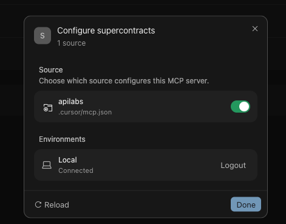
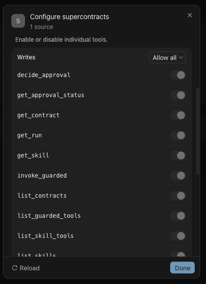

# Cursor

## Hosted MCP — Recommended

Create `.cursor/mcp.json` in your project:

```json
{
  "mcpServers": {
    "supercontracts": {
      "url": "https://mcp.apilabs.ai/mcp",
      "headers": {
        "Authorization": "Bearer <YOUR_API_LABS_MCP_TOKEN>"
      }
    }
  }
}
```

No download or local server process is required.

## Local MCP — Optional

Download, unzip, and start the local SuperContracts MCP release. Confirm `http://127.0.0.1:8080/health` is healthy, then use:

```json
{
  "mcpServers": {
    "supercontracts": {
      "url": "http://127.0.0.1:8080/mcp",
      "headers": {
        "Authorization": "Bearer <YOUR_API_LABS_MCP_TOKEN>"
      }
    }
  }
}
```

> Use only one `supercontracts` entry. Remove duplicate global or project entries before reconnecting.

## Verify installation

Reload Cursor, open **Settings → MCP**, and confirm that `supercontracts` is connected.

<p align="center">
  
</p>

Confirm the tool list is populated and includes `list_contracts`, `get_contract`, `run_contract`, and `get_run`.

<p align="center">
  
</p>

Then ask Cursor:

```text
Use SuperContracts to list my saved contracts with their names and connection IDs.
```

The screenshots show the optional local connection. Hosted MCP exposes the same SuperContracts tools and contract workflow.

Continue with [Run your first protected action](../quick_start/run-your-first-protected-action.md).

[Back to AI Clients](./README.md)
